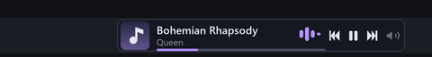
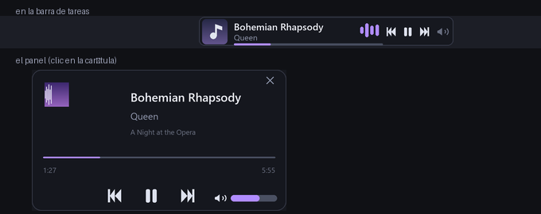

# Astra-Music-widget

[](https://github.com/eduardofleitass/AstraMusicWidget/releases/latest)
[](https://github.com/eduardofleitass/AstraMusicWidget/releases)
[](LICENSE)
[](#requisitos)
[](#requisitos)

Widget de musica que vive **dentro** de la barra de tareas de Windows: caratula, titulo,
artista, barra de progreso clicable, controles y **el volumen de la app que suena**. Lee la
sesion de multimedia del sistema, asi que anda con cualquier reproductor (Spotify, VLC, y lo
que suene en Chrome, Edge o Brave), sin plugins ni integraciones.

### [⬇️ Descargar la ultima version](https://github.com/eduardofleitass/AstraMusicWidget/releases/latest)

Instalador (menu Inicio, arranque con Windows y desinstalador) o **portatil de un solo
archivo**. Ninguna de las dos necesita Python instalado.



<details>
<summary><b>English</b> — what it is, how to download, notes</summary>

A music widget that lives **inside** the Windows taskbar: album art, title, artist, a
clickable progress bar, transport controls and **per-app volume**, read from the system's
media session (SMTC) so it works with Spotify, VLC and anything playing in the browser.
Python + raw Win32 — no UI framework, no dependencies bundled.

- **Download** the [latest release](https://github.com/eduardofleitass/AstraMusicWidget/releases/latest):
  an installer (Start Menu shortcut, start with Windows, uninstaller) or a single portable
  `.exe`. Neither requires Python on the target machine.
- **Requires** Windows 10 1809 or later. On **Windows 11** the taskbar no longer allows
  embedding a window, so the widget runs as a floating strip pinned to the bottom edge
  (same drawing, same clicks, same hotkeys).
- **SmartScreen**: the binaries are unsigned, so Windows shows "Windows protected your PC"
  the first time — *More info* → *Run anyway*.
- **Known limits**: nothing can draw over an exclusive-fullscreen game; the audio bars are
  an animation (Windows does not expose audio levels through this API); it lives in one
  taskbar at a time.
- The detailed documentation is in Spanish (this is an Argentine project). The code, the
  release notes and this summary are enough to get started.

</details>

Muestra lo que esta sonando **dentro** de la barra de tareas de Windows 10:
caratula, titulo, artista, barra de progreso y botones de anterior / play-pausa /
siguiente. Se ve como una parte nativa de la barra y reserva su propio espacio.

```
[ Inicio ][ buscar ][ tareas... ][ ▣ Bohemian Rhapsody  ▁█▃▅ ][ ⏮ ⏸ ⏭ ][ 19°C ][ reloj ]
                                  [   Queen         ▂▂▂▂▂▂▂▂ ]
```

No hay que configurar nada por reproductor: se engancha al **SMTC**, el bus de
medios de Windows. Funciona con Spotify, YouTube y cualquier web en Chrome /
Edge / Brave, VLC, Groove, foobar2000, etc. Cualquier app que respete el sistema
publica ahi titulo, caratula, estado y posicion, y acepta los comandos.

Probado en Windows 10 22H2 (19045), escala 100% y 1920x1080.


## Uso

| Que queres | Como |
|---|---|
| Arrancar el widget | doble clic en `run.vbs` |
| Que arranque solo con Windows | `install_startup.bat` |
| Sacarlo del arranque y detenerlo | `uninstall_startup.bat` |
| Mostrar / ocultar sin cerrarlo | `Ctrl + Alt + M` (la misma tecla lo vuelve a mostrar, con un fundido) |
| Manejar la musica desde cualquier lado | `Ctrl+Alt+P` play/pausa, `Ctrl+Alt+←/→` anterior/siguiente, `Ctrl+Alt+↑/↓` volumen, `Ctrl+Alt+Shift+↑/↓` ±10 s |
| Atrasarlo o adelantarlo | clic en la barra de progreso, o la rueda del mouse (±10 s; con `Ctrl` ±1 s, con `Shift` ±60 s) |
| Ondas de sonido (animacion) | clic derecho > *Ondas de sonido* |
| Color de la barra o de las ondas | clic derecho > *Color de la barra* / *Color de las ondas* |
| Ver la cancion en grande | clic en la caratula (o clic derecho > *Abrir el panel*) |
| Jugando (overlay chico, que no moleste) | clic derecho > *Panel* > *Modo gaming*; se abre y cierra con `Ctrl+Alt+O` |
| Volumen de lo que suena | pasá el mouse por el altavoz y arrastrá la barra que aparece; rueda del mouse encima del altavoz (±5%); clic seco = silencio |
| Ponerlo en la barra de otro monitor | arrastralo al otro monitor, o clic derecho > *Monitor* |
| Fondo transparente | clic derecho > *Fondo* |
| Moverlo a otra parte de la barra | arrastralo con el boton izquierdo (el menu tiene *Volver al extremo derecho* para dejarlo donde nace) |
| Menu (ondas, fondo, adelantar/atrasar, mover, ancho, salir) | clic derecho sobre el widget |
| Detenerlo | clic derecho > Salir, o `python tools\stop.py` |
| Reinstalar dependencias | `setup.bat` |

Si nunca corriste nada todavia, empeza por `setup.bat`.


## Como se ve



A la izquierda de los botones: caratula, titulo con marquesina, artista, ondas y la barra
de progreso. Abajo, el panel que se abre con un clic en la caratula.

- **Caratula** de la cancion, con esquinas redondeadas.
- **Titulo**: si no entra en el ancho disponible, se desplaza en bucle
  (marquesina) con un desvanecido en el borde. Al cambiar de tema vuelve al
  principio.
- **Artista** recortado con puntos suspensivos.
- **Barra de progreso** que avanza suave aunque el reproductor informe la
  posicion cada varios segundos (ver *Interpolacion del tiempo*), y que ademas
  **se puede mover**: clic o arrastre para saltar a cualquier parte del tema.
- **Botones** que se iluminan al pasar el mouse. Cuando un reproductor no ofrece
  algun control, el boton se dibuja atenuado.
- **Ondas de sonido** (opcional): barras que bailan entre el texto y los botones.
  Se prenden y apagan desde el menu contextual.
- **Sin reproduccion**: estado apagado con una nota musical y los controles
  inactivos, en vez de desaparecer.
- **Fondo regulable**: de chip solido a *sin fondo*, donde el widget queda
  flotando sobre la barra y solo se ven la caratula, los textos y los botones.
- **Posicion libre**: se lo puede arrastrar a cualquier parte de la barra donde
  entre, y no vuelve solo a su lugar.


## Fondo transparente

Clic derecho > *Fondo*, con cuatro niveles: **solido** (por defecto),
**translucido**, **muy transparente** y **sin fondo**.

No es un truco de color: la ventana se crea con `WS_EX_LAYERED` y se presenta con
`UpdateLayeredWindow`, asi que el alpha de cada pixel del chip se compone contra
lo que hay de verdad detras. Medido comparando la misma franja de pantalla con el
widget encima y con esa zona pelada: con *sin fondo* la diferencia es **0,00** (o
sea, el widget es invisible y se ve la barra tal cual), y con los niveles
intermedios 8,5 y 13,9, contra 19,1 del chip solido.

Ese estilo servia solo para ventanas de nivel superior hasta Windows 7; desde
Windows 8 tambien vale para ventanas **hijas**, que es lo que permite hacerlo
dentro de la barra.

Como el fondo ya no es fijo, los colores del tema se eligen solos segun la barra:
si el fondo es claro, el texto y los iconos pasan a oscuros (`auto_contrast`), asi
que tambien se lee bien con el tema claro de Windows.

Si preferis el metodo clasico (mezclar el chip contra un color muestreado de la
barra, sin alpha real), `"bg_mode": "opaque"` en `config.json`.


## Mover el widget por la barra

Se arrastra con el boton izquierdo desde cualquier parte que no sea un boton
(sobre el titulo o la caratula). Mientras se arrastra el cursor cambia a ↔.
El menu tiene *Volver al extremo derecho* para devolverlo a su lugar original.
La posicion se guarda en `config.json` (`position_frac`) y se respeta al arrancar.

El widget reserva su espacio dentro del tramo libre de la barra (entre la lista
de tareas y el bloque de la bandeja) y le pide a la lista de tareas el ancho que
corresponda, asi que se mueve **junto con** los botones, no por encima.

Dos cosas que Windows impone y conviene saber:

- **La lista de tareas tiene un ancho minimo propio.** Si la dejariamos mas
  angosta de lo que Windows tolera (~500 px con 10 ventanas abiertas), Windows la
  estira sola — y esa lista estirada **tapa** el widget. El widget no adivina ese
  minimo: cuando lo detecta, busca por biseccion la posicion libre mas cercana y
  la usa como limite. O sea que el recorrido real es *desde donde la lista de
  tareas conserva su espacio* hasta el borde del bloque de la bandeja: unos 450 px
  de recorrido en 1920x1080, mas si tenes pocas ventanas abiertas.
- **No se puede quedar por encima de la lista de tareas.** Una ventana hija de la
  barra nace debajo de esa lista, y aunque se la suba con `HWND_TOP`, explorer la
  vuelve a poner arriba en cuanto se toca la barra. Por eso la posicion siempre se
  elige de forma que la lista de tareas no lo tape: es preferible respetar la
  esquina que quedar invisible.

Si el widget queda en el medio, el tramo entre el y el bloque de la bandeja queda
como fondo de barra vacio. Es el precio de poder moverlo; *Volver al extremo
derecho* deja la barra prolija otra vez.


## Atrasar y adelantar

Tres formas, todas por SMTC (o sea, sirven con cualquier reproductor que respete
el sistema, igual que los botones):

- **Clic en la barra de progreso**: salta a esa parte del tema. La zona clicable
  es una franja mas alta que la barra (que mide 2,5 px, imposible de acertar) y
  termina donde empiezan los botones; al pasar el mouse la barra se engrosa.
- **Arrastrar sobre la barra**: mientras se arrastra muestra a donde va a saltar
  (el renglon del artista pasa a decir `2:35 / 4:20`) y recien manda el salto al
  soltar. Si te arrepentis, no hay salto: soltar fuera del widget o abortar el
  arrastre no toca la reproduccion.
- **Rueda del mouse** sobre el widget: adelanta o atrasa `seek_step_s` segundos
  (10 por defecto). El menu contextual tiene los mismos dos items.

Detalles que costaron encontrar:

- **La API de salto pide enteros, no tiempos.** `try_change_playback_position_async`
  espera **ticks de 100 ns** (`int`): pasarle un `timedelta` —que es lo que
  devuelve el timeline al leer— explota con `TypeError`. Y el techo real lo da el
  propio timeline: `min_seek_time` / `max_seek_time`.
- **El reproductor informa la posicion con atraso.** Justo despues de un salto
  puede seguir informando la posicion vieja (medido: ~1 s en YouTube via Brave).
  Si se adoptara ese reporte, la barra volveria sola y despues saltaria de nuevo.
  Por eso hay una *ventana de gracia*: durante 2 s despues de un salto pedido por
  el usuario se ignora un reporte que no coincida con la posicion esperada. El
  ancla local, ademas, se mueve al instante (de forma optimista) para que la barra
  no rebote.
- **Un stream en vivo no admite saltos** (no tiene fin): ahi la barra no se
  dibuja y el clic no hace nada. Los botones siguen funcionando igual.
- **Con el fondo transparente, Windows decide el mouse por el alfa de cada pixel.**
  Las zonas vacias del widget (los huecos entre iconos, el espacio libre) se
  volvian "agujeros": `WindowFromPoint` devolvia `Shell_TrayWnd` y el clic, la
  rueda y el arrastre se los quedaba la barra de tareas. Se arregla con un piso de
  alfa de 2/255 por pixel (`hit_alpha_floor`), invisible (0,8% de mezcla) pero
  suficiente para que toda la superficie reciba el mouse. Medido: la
  transparencia del fondo sigue dando 0,00 de diferencia contra la barra pelada.
- **La barra dibujada y la clicable tienen que terminar en el mismo lugar.** Si la
  barra corre por debajo de los botones (como corria antes, hasta el borde
  derecho), el clic cae en una x y el indicador aparece en otra: se clickea al 50%
  y salta al 60%. Ahora las dos terminan donde empiezan los botones.


## Ondas de sonido

Opcional, apagado por defecto. Clic derecho sobre el widget > *Ondas de sonido*, o
`"show_waves": true` en `config.json`. Son unas barras redondeadas que bailan entre
el texto y los botones:

- **Bailan solo cuando hay musica**: en pausa quedan planas y apagadas (no siguen
  saltando de adorno), y sin reproduccion ni se dibujan.
- **El texto se recorta antes de llegar**: el titulo y el artista dejan la franja
  libre, asi que nunca pasan por debajo de la animacion. Con el widget muy angosto
  las ondas no se dibujan (mejor el texto que el adorno).
- **Cantidad de barras**: `wave_bars` (4 por defecto, hasta 12).

Que son y que no son, para no vender humo: **es una animacion, no un analisis del
audio**. SMTC expone titulo, artista, estado y posicion, pero **no niveles de
sonido**, asi que las alturas se generan con el reloj (cada barra con su frecuencia
y una envolvente lenta encima, para que no se vean como un metronomo). Que la
musica suene o este en pausa si lo sabe, y por eso se comporta distinto. Para que
reaccionen al sonido real habria que capturar el audio del sistema (WASAPI
loopback), que agrega dependencia, permisos y CPU: no entra en este diseno.

### Por que la animacion no cuesta nada

Animar es repintar, y repintar el chip entero cuesta: **4,4 ms por cuadro** medidos
(Pillow en lienzo x3, reduccion LANCZOS, premultiplicado). A 20 cuadros por segundo
eso daria ~9% de un nucleo solo para mover cuatro barras.

La animacion no repinta el chip: el chip completo se dibuja una vez y **se cachea**
(firma sin las ondas), y en cada cuadro solo se dibuja la **tira de las ondas** (24x20
px, a 4x) y se pega encima. Medido: **0,08 ms** copiar la base y pegar la tira, contra
4,4 ms del render completo. Resultado medido en el proceso real: **0,78% de un nucleo**
con las ondas a 20 fps, contra 8,59% repintando todo. Con las ondas apagadas el widget
sigue en ~0% (solo se repinta cuando cambia algo visible).

La frecuencia se puede bajar con `wave_fps` (20 por defecto) si te importa la CPU:
es lo unico que hace que el widget repinte mas seguido que el texto.


## Colores

La barra de progreso y las ondas tienen **su propio color**, independiente del tema.
Se cambian con clic derecho > *Color de la barra* / *Color de las ondas*, que traen
una paleta corta (verde, celeste, violeta, rosa, naranja, amarillo, blanco) y
*Color del tema* para volver al de acento del tema.

Para cualquier otro color, se escribe a mano en `config.json`:

```json
"progress_color": "#56B6FF",
"waves_color": [255, 120, 180]
```

Se acepta `"#RRGGBB"`, `"#RGB"` o `[r, g, b]`, y `null` (por defecto) es *el color
del tema*. Si el color no se entiende, se usa el del tema en vez de fallar.

Dos cosas a tener en cuenta:

- **El auto-contraste no los toca.** Los colores de texto e iconos se adaptan al
  fondo de la barra, pero si vos elegis un color, se usa ese tal cual: uno muy
  oscuro sobre una barra oscura no se va a ver. El menu muestra
  `Personalizado (#RRGGBB)` cuando el color no es de la paleta.
- **El color de la barra** pinta el relleno del progreso, el indicador del arrastre
  y la hora destino que aparece mientras arrastras. **El de las ondas** pinta las
  barras del visualizador (que siguen quedando planas y apagadas en pausa).

Ninguno de los dos cambia el chip, la caratula ni los textos.


## Atajos globales

Funcionan con cualquier ventana en primer plano: no hace falta apuntarle al widget ni
al reproductor. Se registran sobre la ventana controladora, asi que siguen andando
**con el widget oculto**, que es justo cuando mas hacen falta.

| Atajo | Que hace |
|---|---|
| `Ctrl + Alt + M` | Mostrar / ocultar el widget |
| `Ctrl + Alt + P` | Play / pausa |
| `Ctrl + Alt + ←` / `→` | Anterior / siguiente |
| `Ctrl + Alt + ↑` / `↓` | Volumen +5% / -5% |
| `Ctrl + Alt + Shift + ↑` / `↓` | Adelantar / atrasar el paso configurado (10 s) |
| `Ctrl + Alt + O` | Abrir / cerrar el panel (para no soltar el mouse jugando) |

- La **rueda del mouse** sobre el widget tambien tiene pasos: sin modificador el paso
  normal (±10 s), con `Ctrl` fino (±1 s, para enganchar un estribillo) y con `Shift`
  grueso (±60 s). Sobre el altavoz, la rueda mueve el volumen (`Ctrl` = 1%).
- **Si otro programa ya tiene una combinacion**, `RegisterHotKey` falla y el widget lo
  escribe en el log con el nombre del atajo que quedo sin registrar (`Ctrl+Alt+flechas`
  suele estar tomado por los drivers de video). No es un fallo silencioso.
- Se apagan con `"hotkeys": false` en `config.json` (no hay interruptor en el menu:
  si los atajos andan, es una opcion que casi nunca se toca).

## Volumen

El widget controla el volumen de **la aplicacion que esta sonando**, no el del
sistema. Es la misma perilla que ves en el mezclador de volumen de Windows, asi que
si estas escuchando musica mientras una reunion habla, bajas la musica sin quedarte
sordo en la reunion.

Esta en la **celda del altavoz**, despues de los botones del transporte:

- **Con el cursor encima**, la fila del progreso se convierte en la barra de volumen
  (mas gruesa, con su perilla) y el renglon del artista dice el porcentaje. La fila no
  gana lugar propio: reusa la del progreso, que ya tiene la zona clicable comoda.
- **Arrastrar** sobre esa barra (o un clic seco en cualquier punto) fija el nivel.
- **Rueda del mouse** sobre el altavoz: ±5% por muesca (el paso se configura).
- **Un clic seco en el altavoz** silencia y lo vuelve a sacar. El icono se dibuja con
  una cruz mientras esta en silencio.
- Todo se maneja desde la celda del altavoz: clic seco silencia, la rueda sube y
  baja de a 5%, el arrastre lo deja donde lo sueltes. El menu ya no repite eso.

SMTC dice **que** suena, pero no su volumen: para eso el widget habla con la API de
audio de Windows (Core Audio), la del mezclador. Eso trae dos detalles que valen la
pena saber:

- La sesion de audio de una app suele **no incluir su PID en SMTC**, asi que se
  emparejan por **nombre de ejecutable** (`brave.exe`, `spotify.exe`...), que es lo
  unico que ambos lados comparten.
- Un navegador suele abrir **varias sesiones** (una por proceso de audio). El widget
  las mueve todas juntas: es lo que hace el mezclador.

Si la app que suena no tiene sesion de audio (algunos reproductores rutean el sonido
de otra forma), el altavoz se dibuja **atenuado** y no hace nada: antes de mentirte
con un control que no controla, lo muestra apagado.

No agrega dependencias: pywin32 y winsdk no exponen estas interfaces, asi que los
objetos COM se llaman a mano con `ctypes` (`widget/volume.py`) y COM se inicializa una
vez en el hilo de la ventana.

## Varios monitores

En Windows 10 **cada monitor tiene su propia barra de tareas**, asi que el widget
puede vivir en cualquiera de ellas. Hay dos formas de mudarlo:

- **Arrastralo al otro monitor**: si lo llevas al tramo de la barra de otro monitor,
  el widget se muda ahi solo y el arrastre sigue. La ventana es hija de la barra, asi
  que mudarla es recrearla: el proceso devuelve el espacio a la barra vieja, la crea
  en la nueva y le reserva su lugar.
- **Clic derecho > *Monitor***: lista las barras disponibles ("Principal (1920x1080)",
  "Monitor 2 (1366x768)") y deja tildada la que esta en uso. El submenu solo aparece
  si hay mas de una barra.

La eleccion se guarda en `config.json` (`taskbar_monitor`, el nombre del dispositivo,
p. ej. `"\\.\DISPLAY5"`) y se respeta al arrancar. Si ese monitor ya no esta, vuelve
solo a la principal.

Lo que cambia por dentro (y costo encontrar): las barras **no tienen la misma
estructura**. En la principal la lista de tareas cuelga de `ReBarWindow32` y el ancla
es el bloque de noticias; en las secundarias no hay rebar (la lista vive dentro de un
`WorkerW`) y el ancla es el reloj (`ClockButton`). Medido: Windows respeta que se le
encoja el `WorkerW` igual que la rebar de la principal.

El movimiento (arrastrar, *Volver al extremo derecho*, posicion libre)
funciona igual dentro de la barra donde este, entre la lista de tareas y el bloque de
la derecha de **ese** monitor.


## Como funciona

Tres piezas bien separadas:

| Archivo | Responsabilidad |
|---|---|
| `widget/media.py` | Lee el SMTC en un hilo propio con su propio event loop asyncio. Publica una foto inmutable (`MediaState`) y despacha los comandos. |
| `widget/panel.py` | El panel del mini reproductor: geometria (zonas clicables), dibujo con Pillow y que hay bajo el cursor. Separado del widget para poder verificarlo sin ventana. |
| `widget/draw.py` | Dibuja el widget con Pillow en un lienzo ampliado x3 y lo reduce con LANCZOS: asi los bordes redondeados, los iconos vectoriales y el texto salen suaves sin depender de GDI+ ni de un framework de UI. Con el fondo transparente la reduccion se hace en espacio premultiplicado, para que no quede un halo oscuro en los bordes. Las ondas de sonido se dibujan aparte, en su propia tira, para poder animarlas sin repintar el chip. |
| `widget/volume.py` | Volumen de la app que suena, por la API de audio de Windows (Core Audio) con `ctypes`: enumera las sesiones de audio del dispositivo por defecto, las empareja por ejecutable y lee/escribe volumen y silencio. |
| `widget/app.py` + `taskbarwin.py` | Ventana Win32, superficie de doble buffer (DIB + `BitBlt`, o en capas con `UpdateLayeredWindow` cuando el fondo es transparente), entrada de mouse, arrastre, anclaje y posicion en la barra. |

### La incrustacion en la barra

Windows 10 no tiene API de "bandas" (se elimino despues de Vista), pero acepta
ventanas hijas de la barra de tareas. El procedimiento:

1. crear la ventana como hija de la barra con `WS_CHILD`
2. apoyarla contra el borde izquierdo del bloque de la derecha (noticias en la
   principal, reloj en las secundarias)
3. encoger el contenedor de la lista de tareas para liberar exactamente ese ancho
4. devolver a la lista su **ancho natural** al salir

El contenedor y el ancla cambian segun la barra:

| monitor | barra | contenedor de la lista | ancla |
|---|---|---|---|
| principal | `Shell_TrayWnd` | `ReBarWindow32` | `DynamicContent2` (o la bandeja) |
| secundario | `Shell_SecondaryTrayWnd` | `WorkerW` | `ClockButton` |

Detalles que costaron encontrar:

- **Coordenadas**: en ventanas hijas, `SetWindowPos` usa coordenadas relativas al
  **cliente del padre**, no a la pantalla. Mezclarlas manda la barra fuera de
  lugar. Pasa igual al leer con `GetWindowRect`, que devuelve coordenadas de
  pantalla.
- **El color de fondo se muestrea solo en modo opaco**: en `bg_mode: "opaque"` el
  chip es levemente translucido, asi que se lee el color real de la barra con
  `GetPixel` y se mezcla ahi. En `layered` (por defecto) no hay nada que muestrear:
  la transparencia se resuelve con el alfa de cada pixel.
- **`DynamicContent2` se mueve solo**: el bloque del clima cambia de tamano por su
  cuenta. Por eso el layout se recalcula periodicamente y el widget sigue a su
  ancla en lugar de quedar desalineado.
- **`SetWindowPos` antes de crear**: la ventana se reserva y se crea ya en su
  sitio. Si naciera en `(0,0)` parpadearia un instante encima del boton Inicio.

### Interpolacion del tiempo

Los reproductores informan la posicion cada varios segundos, no de forma
continua. Si se usara ese valor directo, la barra de progreso avanzaria a saltos.
`MediaState.live_position()` extrapola usando el reloj, y el ancla temporal solo
se mueve cuando el reproductor reporta un **avance real**. Si el ancla se moviera
en cada ciclo de sondeo, la extrapolacion nunca acumularia tiempo y la barra
quedaria congelada (fue un bug real, medido: posicion clavada en 49,1 s durante
6 s con la musica sonando).

### Que reproductor se muestra

Windows marca una "sesion actual" propia, pero puede quedarse apuntando a un
reproductor **pausado** aunque otro este sonando. Como la preferencia es seguir
al ultimo que emitio sonido, el widget prioriza lo que realmente suena, con
preferencia *pegajosa* para no saltar entre dos fuentes a la vez:

1. la sesion que Windows marca como actual, **si esta sonando**
2. la que ya venia mostrando, si sigue sonando
3. cualquier otra que este sonando
4. si nada suena, la que Windows marque como actual (asi una cancion en pausa se
   sigue viendo)

### Por que no se repinta de mas

Cada ciclo se calcula una *firma* de lo visible (caratula, titulo, estado,
progreso redondeado al pixel de la barra, hover, posicion de la marquesina). Solo
se redibuja si la firma cambia. En reposo el consumo medido es **0,00% de CPU** y
unos **5 MB de RAM**; la barra de progreso cambia de pixel cada ~1,3 s en un tema
de 3 minutos, asi que no tiene sentido repintar 10 veces por segundo. Con las ondas
de sonido encendidas hay **dos firmas**: la del chip (sin las alturas) cachea el
dibujo completo, y la animacion solo vuelve a dibujar y pegar su tira. Medido:
0,78% de un nucleo a 20 cuadros por segundo, contra 8,59% si se repintara todo.


## Resiliencia

Esta disenado para **nunca dejar la barra de tareas rota**, que es el peor modo de
falla posible de esta tecnica:

- Al arrancar, primero **sanea**: devuelve la lista de tareas a su ancho natural
  antes de reservar. Si una ejecucion anterior murio sin limpiar, se corrige y no
  se acumula el encogimiento.
- Si `explorer.exe` se reinicia, la ventana controladora sobrevive (es de nivel
  superior, no hija de la barra), recibe `TaskbarCreated` y reconstruye el widget.
- Si la ventana del widget muere por cualquier motivo, un chequeo periodico la
  reconstruye y la vuelve a anclar.
- Si la barra se reacomoda y le roba el espacio, el widget lo recupera solo.
- El atajo `Ctrl+Alt+M` es la salida de emergencia: si algo saliera mal, oculta el
  widget sin depender del mouse.
- `python tools\stop.py --force` mata el proceso y repara la barra si quedo
  inconsistente.

96 de 97 pruebas pasan (`python tools\selftest.py` con el widget en marcha; la que se
salta es la de restaurar el color del tema, que no aplica cuando ya elegiste uno):
anclaje, reconstruccion forzada, recuperacion de espacio, pixeles realmente
pintados, transparencia del fondo medida contra la barra, recorrido completo del
movimiento (que nunca quede tapado), la barra de progreso (que su zona clicable
no pise los botones, que el arrastre llegue al destino y muestre la hora, que al
abortar no se mande ningun salto), que el widget reciba el mouse en toda su
superficie con el fondo transparente, las ondas de sonido (que su franja entre
entre el texto y los botones, que apagadas la franja quede lisa, que encendidas
cambien de cuadro —7 de 8 distintos— que el texto quede recortado antes y que no
se salgan de su franja), los colores elegidos (que se entiendan en hex, lista y
corto; que la barra tome el suyo —medido en rojo puro— que las ondas tomen el suyo
—medido en azul— y que ninguno tome el del otro), la barra de otro monitor (que el
widget se mude, quede dentro de esa barra, que ese monitor le ceda el espacio y
que la barra que deja recupere su ancho natural, ida y vuelta) y 30 muestras de
vigilancia del pintado (30/30 cuadros correctos). Y 20 de 20 de interaccion real
(`python tools\clicktest.py`): el hover ilumina los tres botones, un clic de verdad
cambia el estado de reproduccion, el segundo clic lo restaura, un clic en la
caratula no dispara nada, un clic en la barra de progreso salta a esa posicion
(medido: pedido 157 s, informado 157 s) sin mover el widget, el salto se puede
devolver a donde estaba, la rueda adelanta y atrasa el paso configurado (medido:
-9,9 s para un paso de -10 s) y arrastrar el widget a la barra del otro monitor lo
muda de barra y la vuelta lo devuelve, el volumen de la app se mueve con la rueda
(medido: 30% -> 35%), el arrastre sobre la fila del volumen lo deja donde se apunta
(medido: 75%) y un clic real en el altavoz silencia y lo vuelve a sacar.
Ademas comprueba los fundidos: que el cuadro del medio del cambio de caratula este
efectivamente mezclado (medido: 69,1 del lado de la tapa vieja y 70,5 del de la nueva,
sobre un cambio total de 139,6) y que el mostrar/ocultar pase por un estado intermedio
(medido: 1920 pixeles dibujados visibles -> 1590 a mitad del fundido -> 0 oculto).
Del panel comprueba las dos mitades y los dos tamanos: sin ventana, que cada parte
pinte donde tiene que pintar (caratula, textos, barra, controles), que reaccione al
hover, al arrastre y al silencio, que las zonas entren y no se pisen, que sepa que hay
bajo el cursor y que el chico sea mucho mas chico (medido: 41% del area del normal); y
en vivo que se abra, sea un globo, quede encima del widget y dentro del monitor, este
pintado, que con el fondo en 0 no quede **nada** dibujado atras y que el texto se de vuelta
para contrastar (medido: 213 de contraste con fondo claro, 210 con oscuro), y el modo
gaming: que quede chico (320x178 -> 280x84), que no le robe el foco
(`NOACTIVATE` + `TOPMOST`), que tocar afuera **no** lo cierre, que con "clics al juego"
el clic pase de largo y que el auto-ocultar lo cierre solo.
En `clicktest.py` se prueba con clic real: un clic seco en la caratula lo abre, el
play/pausa cambia la reproduccion, un clic al 70% de su barra salta ahi (medido: pedido
129 s, informado 128 s), un clic en su barra de volumen lo deja en el 30% (medido 29%) y
la cruz lo cierra.

Y 18 de 18 de atajos con **teclas reales** (`python tools\hotkeytest.py`): `Ctrl+Alt+P`
cambia la reproduccion, `Ctrl+Alt+←/→` cambia de tema, `Ctrl+Alt+Shift+↑/↓` mueve
exacto (+10,0 s y -10,0 s medidos con la musica en pausa, para que la interpolacion no
contamine la medicion), `Ctrl+Alt+↑/↓` mueve el volumen (50% -> 55% -> 50%),
`Ctrl+Alt+M` oculta y muestra, la rueda con `Ctrl`/`Shift` da pasos distintos (medido:
+1,0 s / +60,0 s / +10,0 s) y apagar los atajos desde el menu los desactiva de verdad
(con los atajos apagados `Ctrl+Alt+P` no hace nada, y al prenderlos vuelve a andar),
`Ctrl+Alt+O` abre y cierra el panel, y el HUD abre el panel solo al cambiar de cancion.

En `clicktest.py`, si una lista de reproduccion cambia de tema justo mientras se
mide, el comando se pierde y la prueba lo informa como `SALTA` (interferencia) en
vez de inventar un fallo que no existe.

`clicktest.py` mueve el cursor de verdad, asi que **si estas usando el mouse
mientras corre tus movimientos compiten con los que inyecta**. La prueba lo
detecta, lo informa como `SALTA` en vez de inventar un fallo, y te dice que sueltes
el mouse y la corras de nuevo.

Ademas se probo a mano lo que mas duele: matar el proceso a la fuerza deja la
barra encogida, y el arranque siguiente la sanea sola sin acumular el
encogimiento.


## Panel (mini reproductor)

Un clic seco en la **caratula** abre un panel flotante con la cancion en grande:
caratula de 92 px, titulo, artista, album (o el nombre de la app si no hay album),
barra de progreso clickeable con los tiempos, los controles de transporte y el
volumen de la app. Todo lo que se puede hacer ahi es lo mismo que en el widget, pero
con lugar para leer y apuntar bien.

- **Abre** con un clic seco en la caratula del widget o desde el menu (*Abrir el
  panel*). Un arrastre sobre la caratula sigue moviendo el widget: el panel se abre
  solo si no hubo movimiento.
- **Cierra** con la cruz, con `Escape`, con un clic afuera (pierde el foco) o con otro
  clic en la caratula.
- **Tres tamanos** (menu > *Panel* > *Tamano*): *Normal* (320x178, caratula grande y tres
  lineas), *Chico* (280x84, dos filas) y *Tira fina* (320x34, **una sola fila**: caratula
  de 24, titulo y artista, barra de 2 px, los tres controles, el altavoz y la cruz). La
  tira es para jugar en ventana sin tapar nada.
- **Con el panel abierto, el teclado manda**: `Espacio` play/pausa, flechas `←` `→`
  adelantan y atrasan (con `Ctrl` de a 1 s, con `Shift` de a 60 s), `↑` `↓` el volumen y
  `Escape` lo cierra. Vale en el modo escritorio, que es cuando el panel tiene el foco; en
  modo gaming el panel no toma el foco a proposito, asi que ahi se usan los atajos
  globales (que andan igual con el juego adelante).
- **La rueda tambien anda en el panel**: sobre el altavoz mueve el volumen y en el resto
  adelanta o atrasa, igual que en el widget.
- **Se imanta a los bordes**: al soltarlo, si quedo a menos de 22 px de un borde o de una
  esquina del monitor (o del borde de arriba de la barra de tareas), se pega ahi. Nunca
  queda a 3 px del borde, que se ve como un error de dibujo.
- **Doble clic en la caratula**: trae al frente la ventana de lo que esta sonando (el
  navegador o Spotify), para ver el video sin buscarlo. Funciona con cualquier
  reproductor: se busca la ventana del proceso que suena.
- Aparece **encima del widget** (alineado a su borde derecho) y siempre dentro del
  monitor; si no entra arriba, va debajo. Se puede **arrastrar desde cualquier parte
  libre** para moverlo donde quieras (con *Fondo* > *Sin fondo* tambien: las zonas
  vacias siguen agarrando el mouse, ver abajo). Y *Refrescar ahora*, en el menu, vuelve
  a medir el fondo de atras por si cambio mucho.
- Se dibuja solo cuando algo cambia (la firma incluye la posicion redondeada, el hover,
  el arrastre y el estado del volumen) y el widget le presta su ciclo: mientras el panel
  esta abierto el temporizador va a 100 ms, como el de la barra de progreso.

Detalles tecnicos que valen la pena:

- Es una ventana **propia de nivel superior** con `WS_EX_TOOLWINDOW`: no aparece en la
  barra de tareas ni en Alt+Tab, es un globo del widget y no una aplicacion aparte.
  Con `WS_EX_LAYERED` tiene fondo redondeado y translucido (250/255) y se presenta con
  `UpdateLayeredWindow`, igual que el widget.
- El cierre por "clic afuera" es `WM_ACTIVATE` con `WA_INACTIVE`, el mismo mecanismo que
  usan los globos del sistema.
- Empezar un arrastre del widget (o mudarlo de barra) **cierra el panel primero**:
  medido, si el panel se cerraba en el medio de un arrastre, la transicion de foco se
  comia el `mousedown` y el arrastre no arrancaba.
- Las zonas clicables se calculan en `widget/panel.py` y hay una prueba que comprueba
  que entren en el panel y **no se pisen**: la de "siguiente" pisaba la del altavoz por
  3 px y dos zonas que se pisan se roban clics.

### Modo gaming del panel

Para jugar hace falta lo contrario que para el escritorio: que el panel **tome menos
pantalla** y que **no le saque el foco al juego**. Un interruptor en el menu (clic
derecho > *Panel* > *Modo gaming*) prende el conjunto:

| Ajuste | Escritorio | Gaming |
|---|---|---|
| Tamano | 320x178 (caratula grande, 3 lineas) | **280x84** (dos filas: caratula y texto arriba, controles, barra y volumen abajo) |
| Foco | se activa (Escape y clic afuera funcionan) | **no se activa nunca** (`WS_EX_NOACTIVATE` + `WM_MOUSEACTIVATE` → `MA_NOACTIVATE`) |
| Al tocar afuera | se cierra | **sigue abierto** |
| Capas | normal | **siempre arriba** (`WS_EX_TOPMOST`, sirve sobre juegos en ventana) |
| Auto-ocultar | nunca | **nunca: queda fijo** hasta que lo cierres |
| Al cambiar de cancion | no aparece | no aparece solo (se abre cuando vos queres, con `Ctrl+Alt+O`) |
| Fondo | solido | **solido** (el submenu *Fondo* lo gradua hasta "sin fondo") |

- Se abre y cierra con **`Ctrl+Alt+O`**, sin soltar el mouse. Los controles del panel
  siguen andando con clic, y los atajos globales (play/pausa, siguiente, volumen,
  ±10 s) funcionan con el juego en primer plano.
- **Recuerda donde lo dejaste**: si lo arrastras, se queda ahi (en el menu hay
  *Volver a anclarlo al widget*).
- **Dejar pasar los clics al juego** (`WS_EX_TRANSPARENT`): el panel queda solo para
  mirar y los clics van al juego como si no estuviera. Se maneja con los atajos.
- **Fijo**: en modo gaming no se oculta solo ni se cierra al tocar el juego; queda
  donde lo dejaste hasta que lo cierres con `Ctrl+Alt+O`, la cruz o el menu.
- **El fondo y la opacidad son dos cosas distintas** y se ajustan por separado:
  *Fondo* cambia el recuadro de atras (de *Solido* a *Sin fondo*) y *Opacidad de todo
  el panel* cambia todo junto, textos incluidos.
- **Sin fondo es sin fondo**: con *Fondo* > *Sin fondo (solo los datos)* no queda
  **nada** dibujado atras (ni el borde) y el panel queda flotando: solo la caratula, los
  textos, los controles y las barras. Medido: al abrirlo y cerrarlo cambian solo el 35%
  de los pixeles de su area (los del contenido); antes, con un piso de alfa que tenia el
  dibujo, cambiaban el 100%.
- **Sin fondo el texto se adapta solo, midiendo bien**: al abrirse, el panel captura
  **el propio rectangulo mientras todavia esta oculto** (asi ve el fondo limpio: con el
  panel ya visible, la captura devuelve el panel mismo) y elige el color del texto con
  ese dato. Texto oscuro **solo si el fondo es claro y parejo** (brillo > 170 y desvio
  < 45); en cualquier otro caso usa texto claro con contorno oscuro, que se lee sobre
  casi todo. Medido: con fondo claro el texto queda 213 mas oscuro y con fondo oscuro
  210 mas claro, y el contorno es del color opuesto.
  > El detalle importa: antes el panel promediaba cuatro franjas *al lado* suyo, y si
  > una tenia contenido claro ajeno (una ventana blanca abajo) concluia "fondo claro" y
  > ponia texto oscuro con contorno claro: sobre un fondo oscuro eso son **letras
  > huecas** con un halo, que es lo que se veia mal.
- **Las zonas "vacias" tambien reciben el mouse**: con *Sin fondo* los pixeles del panel
  quedan con alfa 2 (0,8%, invisible), no con 0. No es capricho: Windows decide que
  ventana recibe el clic mirando el alfa **por pixel**, asi que con 0 el hueco es un
  agujero y el clic y el arrastre se los queda la ventana de atras. Medido: sobre el
  fondo del panel, `WindowFromPoint` devolvia la ventana del navegador en 66 de 98
  puntos de una grilla; con el piso, 98 de 98 caen en el panel.
- Cada ajuste se puede tocar por separado desde el mismo submenu, si no queres el
  paquete completo.

Lo que **no** se puede, y conviene saberlo: sobre un juego en **pantalla completa
exclusiva** ninguna ventana puede dibujarse encima (Windows le da la pantalla al juego;
solo se podria con un hook tipo inyeccion). Sobre juegos en **ventana** o **pantalla
completa sin bordes** (que es como juega la mayoria hoy) el overlay se ve perfecto.

## Fundidos

Dos transiciones, para que el widget no cambie a los saltos:

- **Al cambiar de cancion**, la caratula nueva se funde con la anterior durante
  `fade_cover_ms` (220 ms). Antes la tapa saltaba de golpe.
- **Al mostrar y ocultar** con `Ctrl + Alt + M`, el widget aparece y desaparece con un
  fundido de ~300 ms.

Como se hacen, y por que no cuestan CPU:

- El de la caratula mezcla las dos imagenes ya dibujadas (`Image.blend`). Es correcto
  mezclar en alfa recto porque donde las dos tienen el mismo alfa (todo el chip, los
  textos, la tapa) el resultado es identico al de mezclar en premultiplicado; solo
  difiere en los bordes donde una tapa tiene silueta y la otra no, que son un par de
  pixeles durante 200 ms.
- El de mostrar/ocultar **no redibuja nada**: cambia el `SourceConstantAlpha` de la
  ventana en capas, o sea el alfa de todo el cuadro de una sola llamada. El widget se
  oculta de verdad (y suelta el espacio de la barra) recien cuando el alfa llega a 0.
- Los dos aceleran el temporizador a 30 ms **solo mientras duran** (~33 cuadros por
  segundo): con el ritmo normal (100 ms) un fundido de 220 ms tendria dos cuadros y se
  veria a saltos. Terminado el fundido, el temporizador vuelve solo.
- Con el fondo opaco (`bg_mode: "opaque"`) no hay alfa global que animar, asi que el
  mostrar/ocultar sigue siendo instantaneo; el de la caratula funciona igual.

## Windows 11: modo flotante

Windows 10 deja incrustar una ventana en la barra (hijo de `Shell_TrayWnd`), y de eso
vive todo el anclaje. **Windows 11 no**: ahi la barra la dibuja XAML, y una ventana hija
no se pinta nunca — existe, contesta que esta visible, esta bien ubicada y no aparece.
El programa lo **comprueba** al arrancar mirando la estructura y no la version de Windows:

1. tiene que haber contenedor (`ReBarWindow32`) y ancla (el reloj o la bandeja) de verdad, y
2. la barra no puede ser la nueva, y esto se detecta por cualquiera de dos senales: el
   **puente de composicion XAML** (`Windows.UI.Composition.DesktopWindowContentBridge`,
   titulo `DesktopWindowXamlSource`) tapando el area de la barra, o la lista de tareas
   legacy (`MSTaskListWClass`) apagada dentro del `ReBarWindow32`.

Si la barra no sirve, pasa solo al **modo flotante**:

> Por que hacen falta las dos senales: en Windows 11 24H2/25H2 (build 26300, medido) el
> `ReBarWindow32` y el reloj **si existen y estan visibles**, asi que preguntar solo por
> ellos daba "se puede incrustar": el widget se creaba como ventana hija de la barra,
> Windows lo reportaba visible y quedaba enterrado debajo del puente XAML, sin dibujarse
> jamas. Se veia igual que un programa que no arranca. `python tools\diagnostico_barra.py`
> vuelca ese arbol (con el z-order) para comprobarlo en la maquina de cualquiera.

- El widget se dibuja como **ventana propia**, pegada a la franja de abajo del monitor
  (encima de la barra, en el hueco libre entre los iconos y el reloj), con el mismo
  dibujo, el mismo clic, los mismos atajos y la misma transparencia real (el escritorio
  se ve a traves).
- No le pide nada a la barra: la lista de tareas conserva su ancho. Se lo comprueba en la
  prueba dedicada (1178 px antes y despues).
- Es un adorno: sin entrada en Alt+Tab (`WS_EX_TOOLWINDOW`) y siempre arriba
  (`WS_EX_TOPMOST`).
- El alto de la franja no se adivina: sale del **area de trabajo** del monitor (que ya
  viene sin la barra). Medido: 40 px en Windows 10; en Windows 11 la barra mide 48.
- `flotante_reserva_derecha` (300 px) es el hueco que se le deja al reloj y los iconos de
  la bandeja a la derecha.

**Como se prueba sin tener Windows 11**: `python main.py --flotante` fuerza el modo en
cualquier Windows, asi que la misma ventana, el mismo dibujo y el mismo clic se verifican
en Windows 10 con `python tools/flotante_test.py` (12 comprobaciones: geometria, que no
reserve espacio, que dibuje, que el play/pausa responda, que el panel abra con
`Ctrl+Alt+O`, y que al terminar vuelva el widget de la barra). Lo que **no** se puede
verificar asi es la barra real de Windows 11 (donde el modo se elige solo): eso pide una
maquina con 11.


## El menu (corto a proposito)

Clic derecho sobre el widget. Queda **solo lo que no se puede hacer de otra forma**:

    Ocultar / Mostrar widget
    Abrir el panel            (lo mismo que el clic en la caratula)
    Panel                     Modo gaming, Tamano, Dejar pasar los clics,
                              Fondo, Opacidad, Volver a anclarlo al widget
    Fondo del widget          solido / translucido / ... / sin fondo
    Opacidad de todo el widget   todo nitido / leve / translucido / muy transparente
    Color del widget          automatico / del tema de Windows / claro / oscuro
    Color de la barra         (y Color de las ondas)
    Monitor                   (solo si hay mas de una barra)
    Ondas de sonido           (interruptor)
    Ancho: N px               Mas ancho / Mas angosto
    Volver al extremo derecho
    Refrescar ahora           vuelve a medir el fondo del panel
    Salir

**Fondo y opacidad son dos cosas distintas** (como en el panel): *Fondo del widget* decide
cuanto se ve la barra de tareas a traves del chip; *Opacidad de todo el widget* es el alfa de
todo el cuadro, asi que tambien apaga el texto y la caratula. *Sin fondo* + *Translucido* deja
el widget flotando sobre la barra con los datos todavia nitidos.

**Color del widget** decide de que color es el fondo: *Automatico* mira lo que hay detras (si
la barra es clara, usa el tema claro), *Del tema de Windows* toma el color con el que el
sistema tiñe la barra de tareas y los bordes (el que se ve en Ajustes → Personalizacion →
Colores, leido con `DwmGetColorizationColor`), y *Claro* / *Oscuro* lo fuerzan sin mirar el
fondo. La opacidad de todo el widget necesita transparencia real: con `bg_mode: "opaque"`
(Windows 10) el menu lo avisa y la opcion no se aplica.

Todo lo que se saco sigue estando, pero por su camino natural: atrasar y adelantar
(barra, rueda, atajos), silenciar y volumen (celda del altavoz, rueda, atajos), mover
paso a paso y centrar (se arrastra), mostrar el altavoz, apagar los atajos y abrir la
carpeta del proyecto (las dos ultimas, desde `config.json`). Un menu de 24 entradas
donde 12 son atajos de cosas que ya se hacen con el mouse es un menu que no se lee.


## Configuracion

`config.json`, se aplica al arrancar. Los cambios por menu (ancho) se guardan solos.

| Clave | Por defecto | Que hace |
|---|---|---|
| `width` | 260 | Ancho en px logicos (se escala solo con el DPI) |
| `min_tasklist_width` | 420 | Minimo de lista de tareas que se respeta al reservar espacio |
| `min_tasklist_free` | 140 | Piso de la lista de tareas cuando el widget se mueve libre (el limite real lo descubre el propio widget) |
| `seek_step_s` | 10 | Cuantos segundos adelanta/atrasa la rueda del mouse y el menu. La barra de progreso se puede clickear en cualquier caso |
| `seek_fine_s` | 1 | Paso de la rueda con `Ctrl` (fino) |
| `seek_coarse_s` | 60 | Paso de la rueda con `Shift` (grueso) |
| `hotkeys` | true | Atajos globales `Ctrl+Alt+...` |
| `hit_alpha_floor` | 2 | Alfa minimo por pixel en modo transparente, para que toda la superficie reciba el mouse (invisible; 0 lo desactiva, pero con el fondo sin nada los huecos se vuelven "agujeros" y los clics van a la barra de tareas) |
| `show_waves` | false | Ondas de sonido animadas entre el texto y los botones (menu > *Ondas de sonido*) |
| `wave_bars` | 4 | Cuantas barras tienen las ondas (1 a 12) |
| `wave_fps` | 20 | Cuadros por segundo de la animacion. El unico motivo por el que el widget repinta mas seguido que el texto |
| `progress_color` | `null` | Color de la barra de progreso (relleno, indicador de arrastre y hora destino). `null` = el del tema; tambien `"#RRGGBB"` o `[r, g, b]` |
| `waves_color` | `null` | Color de las ondas de sonido. Mismas formas que `progress_color` |
| `fade_cover` | true | Fundido al cambiar de caratula |
| `fade_cover_ms` | 220 | Cuanto dura ese fundido |
| `fade_visible` | true | Fundido al mostrar/ocultar el widget (solo con fondo transparente) |
| `fade_step` | 48 | Cuanto cambia el alfa por cuadro en ese fundido (255 / paso = cuadros) |
| `panel_mode` | `"normal"` | `"gaming"` recuerda el estado del interruptor del menu |
| `flotante_reserva_derecha` | 300 | Hueco que se le deja al reloj en modo flotante (Windows 11) |
| `panel_size` | `"normal"` | `"normal"` (320x178), `"chico"` (280x84) o `"tira"` (320x34, una fila) |
| `panel_no_robar` | false | No le saca el foco a lo que este adelante y no se cierra al tocar afuera |
| `panel_topmost` | false | Queda siempre arriba (util con juegos en ventana) |
| `panel_clics_al_juego` | false | Los clics pasan al juego como si el panel no estuviera |
| `panel_auto_hide_s` | 0 | Se oculta solo tras N segundos sin usarlo (0 = nunca) |
| `panel_hud` | false | Aparece un rato al cambiar de cancion |
| `panel_alpha` | 255 | Opacidad de todo el panel (235 leve, 200 translucido, 160 muy transparente) |
| `panel_bg_alpha` | 250 | Alfa del **recuadro de atras** (250 solido, 200, 140, 90, 0 = sin fondo: no se dibuja nada, ni el borde). Con 0 el texto elige claro u oscuro segun lo que haya atras |
| `panel_pos` | `null` | `[x, y]` en pantalla donde lo dejaste arrastrado; `null` = encima del widget |
| `show_volume` | true | Celda del altavoz despues de los botones |
| `volume_step` | 5 | Cuanto sube o baja cada muesca de la rueda sobre el altavoz, en porcentaje |
| `taskbar_monitor` | `null` | Barra de tareas donde vive el widget: `null` = la del monitor principal, o el nombre del dispositivo (`"\\.\DISPLAY5"`). Lo guarda el menu *Monitor* o el arrastre |
| `position_frac` | `null` | `null` = pegado al extremo derecho. `0..1` = posicion libre dentro del tramo util |
| `drag_to_move` | true | Permite moverlo arrastrando con el boton izquierdo |
| `chip_alpha` | 232 | Transparencia del fondo: 232 solido, 170 translucido, 100 muy transparente, 0 sin fondo |
| `widget_alpha` | 255 | Opacidad de **todo** el widget (texto y caratula incluidos). 255 todo nitido, 235 leve, 200 translucido, 160 muy transparente. Necesita `bg_mode: "layered"` |
| `chip_color` | `"auto"` | Color del fondo: `"auto"` (claro u oscuro segun lo que haya detras), `"accent"` (el color con el que Windows tiñe la barra de tareas), `"light"` o `"dark"` |
| `bg_mode` | `"layered"` | `"layered"` = alpha real con `UpdateLayeredWindow`; `"opaque"` = mezcla contra el color muestreado de la barra |
| `auto_contrast` | true | Elige texto e iconos claros u oscuros segun el color de la barra |
| `poll_interval_ms` | 500 | Cada cuanto se consulta el SMTC |
| `timer_playing_ms` / `timer_idle_ms` | 100 / 500 | Cada cuanto se revisa si hay que redibujar |
| `marquee_speed` / `marquee_gap` | 32 / 40 | Velocidad y separacion del bucle del titulo |
| `supersample` | 3 | Factor de suavizado. Bajalo a 2 si te importa la CPU |
| `show_art` / `show_controls` / `show_progress` | true | Que elementos se dibujan |
| `corner_radius` / `chip_alpha` | 7 / 232 | Forma y transparencia del chip |
| `theme` | ver archivo | Colores del chip, borde, textos, acento, pista e iconos |
| `right_click_menu` / `log_file` | true / `astra-widget.log` | Menu contextual y archivo de log |

Si te gusta mas ancho o mas angosto: clic derecho sobre el widget > *Más ancho* /
*Más angosto*. Y el fondo, en el submenu *Fondo*.


## Version

El numero vive en **un solo lugar**: `widget/__init__.py` (`__version__`). Al empaquetar,
`tools/build_exe.py` lo propaga al ejecutable (es lo que Windows muestra en Propiedades) y
al instalador (`instalador/version.iss`, de donde sale el nombre del `setup.exe`). Para
sacar una version nueva: cambiarlo ahi, `python -c "from widget import __version__;
print(__version__)"` para confirmar, y volver a empaquetar. `main.py --version` tambien lo
muestra.


## Empaquetado (.exe)

    python tools/build_exe.py          # dist/Astra-Music-widget.exe (un solo archivo)
    python tools/build_exe.py --dir    # una carpeta en vez de un archivo

- Un solo archivo, sin consola y con el icono de las ondas (`tools/make_icon.py` lo
  dibuja con el mismo criterio que el widget; queda en `assets/`).
- **`--collect-all winsdk`**: los datos de WinRT (los `.winmd`) no los encuentra solo; sin
  eso el ejecutable arranca pero no lee ninguna sesion de multimedia (se ve "sin
  reproduccion" para siempre).
- **La config y el log van al lado del .exe**, no dentro: empaquetado, `__file__` apunta a
  una carpeta temporal que Windows borra al salir (ahi se perderia todo en cada arranque).
  Lo resuelve `config.raiz()` con `sys.frozen`.
- El arranque automatico (`tools/startup.py --install`) prefiere el **.exe** si existe y
  si no el `run.vbs` con el `pythonw` del entorno.
- Verificado: con el .exe en marcha, las tres suites dan lo mismo que con el codigo
  (selftest 102/104, clicktest 37/37, hotkeytest 17/17). Ojo al probarlo: el .exe lee el
  `config.json` que tiene al lado, asi que si queres los mismos ajustes que el proyecto,
  copialo a `dist/` antes de correr el banco.


### Instalador (Inno Setup)

    "C:\Program Files (x86)\Inno Setup 6\ISCC.exe" instalador\Astra-Music-widget.iss
    # deja instalador\Astra-Music-widget-1.0.2-setup.exe (30 MB)

Lo que hace el instalador:

- Instala **por usuario** en `%LOCALAPPDATA%\Programs\Astra-Music-widget`, o sea que
  **no pide administrador** (nada de UAC). Esa carpeta ademas es escribible, asi que el
  programa sigue guardando su `config.json` y su `astra-widget.log` al lado del .exe. En
  `C:\Program Files` no se podria escribir y habria que mudarlos a `%APPDATA%`.
- Crea el acceso del **menu Inicio**, ofrece **escritorio** (opcional) y **arrancar con
  Windows** (viene marcado: es un adorno de la barra), y deja un **desinstalador** que
  aparece en Ajustes → Aplicaciones.
- El `AppId` es un GUID fijo, asi que una version nueva se instala **encima** y no como
  una segunda copia. Y si el widget esta corriendo, lo cierra antes de reemplazar el .exe
  (Windows no deja sobrescribir un ejecutable en uso).
- Al desinstalar **pregunta si conservar los ajustes** antes de borrar `config.json`.
- El ejecutable lleva version en las Propiedades (`instalador/version_info.txt` →
  Astra-Music-widget 1.0.3), asi que Windows muestra quien lo firma y que version es.

Lo que **no** se puede evitar sin pagar: sin firma digital, tanto el .exe como el
instalador disparan el aviso de SmartScreen ("Windows protegio tu PC" → *Mas informacion*
→ *Ejecutar de todas formas*). Un certificado de firma cuesta entre 200 y 400 dolares al
anio; para un proyecto personal no vale la pena.


## Herramientas de desarrollo

```bash
python main.py --no-embed        # ventana flotante, sin tocar la barra
python main.py --diagnose        # ver que esta leyendo del SMTC
python main.py --diagnose --cmd next   # probar un comando contra el reproductor
python main.py --diagnose --seek 120   # probar un salto y ver cuanto se movio
python main.py --shot prev.png   # volcar el widget a un PNG
python main.py --shot s.png --scrub 210   # como se ve el arrastre de la barra
python main.py --shot w.png --waves       # como se ven las ondas de sonido
python tools\watch.py            # estado en vivo, muestreado cada 0,5 s
python tools\preview.py hoja.png # hoja con todas las variantes visuales
python tools\selftest.py         # suite de verificacion (widget en marcha)
python tools\flotante_test.py    # el modo de Windows 11 (ventana propia, sin barra)
python tools\diagnostico_barra.py   # por que se incrusta o pasa a flotante (arbol y z-order)
python tools\build_exe.py        # empaqueta el .exe (y propaga la version)
python tools\make_readme_shots.py   # regenera assets/captura.png (con datos de ejemplo)
ISCC.exe instalador\Astra-Music-widget.iss   # arma el instalador (Inno Setup 6)
python tools\clicktest.py        # prueba de clic real con el mouse (restaura el estado)
python tools\hotkeytest.py       # atajos globales con teclas REALES y rueda con modificadores
python tools\startup.py --status # ver si el arranque automatico esta activo
python tools\stop.py             # cierre ordenado
python tools\debug_mouse.vbs     # arranca con cada mensaje de mouse anotado en el log
python tools\testrig.py          # banco de pruebas: reproductor simulado con 3 pistas
```

Para depurar la entrada de mouse, arrancar con `tools\debug_mouse.vbs`: cada
`WM_MOUSEMOVE`, `WM_LBUTTONDOWN` y `WM_LBUTTONUP` queda anotado en `astra-widget.log`
con sus coordenadas, que devolvio el analisis de zonas (`hit`) y si el punto cae
dentro de la franja de la barra.

`testrig.py` es el mas util para desarrollar: levanta un reproductor falso en
`http://127.0.0.1:8765/` con tres pistas, caratulas distintas y los manejadores
de play / pause / next / prev / **seekto**, asi se prueba todo el circuito
—incluido el salto de posicion— sin depender de Spotify ni de YouTube. La pista
actual y la posicion quedan en `tools/_rig_state.json` para poder comprobar desde
afuera que un clic realmente cambio de tema o movio la reproduccion.


## Requisitos

- Windows 10 1809 o posterior (SMTC necesita esa version). En Windows 11 anda en modo
  flotante (ver esa seccion).
- **O el .exe**: `python tools/build_exe.py` deja `dist/Astra-Music-widget.exe` (27 MB, sin
  consola, con su icono). No necesita Python ni el entorno virtual: es un archivo para
  pasar a otra maquina. Guarda su `config.json` y su `astra-widget.log` **al lado del
  ejecutable**.
- O para correr desde el codigo: Python 3.11. Las dependencias las instala `setup.bat`;
  son tres: `winsdk` (SMTC), `pywin32` (Win32) y `pillow` (dibujo).


## Licencia

MIT (ver [LICENSE](LICENSE)): cualquiera puede usar, copiar, modificar y distribuir este
programa, tambien comercialmente, mientras mantenga el aviso de copyright. El copyright
sigue siendo del autor y el software se entrega **sin garantia** de ningun tipo.


## Limitaciones conocidas

- En Windows 11 **no se incrusta**: esa barra ya no tiene donde alojar una ventana, asi
  que el widget pasa solo al **modo flotante** (una tira propia pegada al borde de abajo,
  ver la seccion de abajo). En Windows 10 se incrusta como siempre.
- Vive en **una** barra por vez (la del monitor que elijas): no se puede duplicar en
  todos los monitores a la vez.
- El anclaje asume barras **horizontales** (abajo). Si moviste la barra a un borde
  lateral o arriba, hay que adaptar el calculo de la posicion.
- Se reserva el ancho de `config.json` de la lista de tareas. Con muchisimas
  ventanas abiertas la lista queda mas corta; `min_tasklist_width` limita cuanto
  puede ceder, y `Ctrl+Alt+M` lo oculta cuando necesites el espacio.
- El recorrido del movimiento depende de cuantas ventanas tengas abiertas: cuanto
  mas angosta necesite ser la lista de tareas, mas a la derecha empieza el tramo
  donde el widget puede vivir. Con pocas ventanas el recorrido es mas largo.
- Si el widget queda en el medio, el tramo que queda entre el y el bloque de la
  bandeja es fondo de barra vacio (no hay forma de partirlo: la lista de tareas es
  una sola ventana del sistema).
- La caratula la entrega el reproductor ya reducida (YouTube via Edge da 150x150,
  Spotify da 300x300), asi que en pantallas con escalado alto puede verse algo
  blanda: se muestran a 32 px logicos, no hace falta mas.
